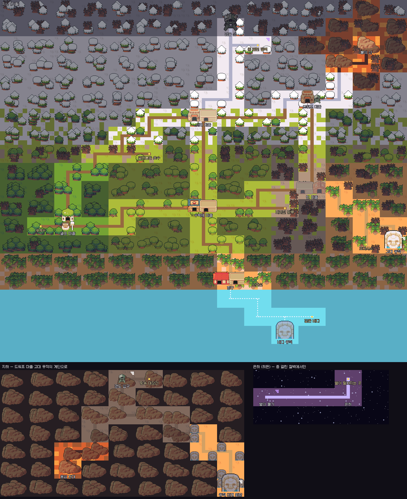

# UNLOAD / DOWNLOAD 기획서

Oct 28, 2026 · @고수

## 개요

웹 브라우저에서 엔딩까지 무료로 즐기는 서브컬처풍 스토리 RPG이고, 엔딩에서 게임을 '다운로드'하는 행위 자체가 이야기의 클라이맥스가 된다.

| 항목 | 내용 |
| --- | --- |
| 장르 | 탑다운 필드 탐험 + 조우 시 사이드뷰 턴제 전투 (포켓몬 구조의 업그레이드) |
| 플랫폼 | 웹(무료, 본편 완결) → 데스크톱 EXE(다운로드판, 추후 유료) |
| 배경 | 겉은 중세 판타지, 속은 SF. 마왕과 기사의 세계지만 실제로는 브라우저 안에서 돌아가는 디지털 세계이고, 전생·세계선·정신체가 그 속을 이룬다 |
| 아트 | 세 겹: 필드는 16px 고퀄리티 픽셀(CC0 팩 기반 변형, 동적 조명·파티클), 중요 장면은 서브컬처 일러스트(에픽세븐 계열), 귀여운 순간은 말랑 SD 이모트. 상세는 docs/아트디렉션.md |
| 서사 형태 | 단편 완결. 관계(그녀)와 정신체 네트워크만 지속 |
| 플레이타임 | 다운로드 전(웹) 20\~30시간 + 다운로드 후 20\~30시간. DLC 별도. 전체 약 60시간 |
| 레퍼런스 | 이터널리턴(캐릭터 개성), 블루아카이브(학원·메신저 감성), 던전앤파이터·라테일(횡스크롤 필드), 에픽세븐(턴제 전투·컷인), 로스트아크(보스 기믹·연출), 원신(탐험의 자유감), 슈타인즈게이트(세계선과 홀로 남은 기억), 영웅서기(스토리가 강한 RPG) |

핵심 키워드는 다섯 개다: 다운로드, 실시간 붕괴, 되돌리기의 대가, 선택으로 빚어진 그녀, 그리고 70억 명의 70억 개의 이야기.

제목은 **UNLOAD / DOWNLOAD**로 확정한다. 웹판과 다운로드판의 이야기를 함께 담은 이름이고, DLC와 후속작은 콜론 뒤에 부제를 붙인다(예: UNLOAD / DOWNLOAD: 부제).

## 핵심 콘셉트: 다운로드

'다운로드'는 판매 수단이 아니라 이야기의 필연이다. 세계를 플레이어의 컴퓨터로 옮기는 순간, 화면 안과 밖을 가르던 선이 사라진다.

- **웹판의 한계가 곧 설정이다.** 갈 수 없는 안개 벽, 흐릿한 원경, 맵 끝의 안개는 개발 제약이 아니라 '좁은 집에서 앓고 있는 세계'의 증상으로 연출한다. 화면 자체는 웹판도 선명하게 그린다(1920×1080, 한 화면에 가로 30칸). 흐릿함은 해상도가 아니라 안개로 보여 준다.
- **다운로드는 구출처럼 보인다.** 사라진 사람들을 되찾으려면 세계를 더 넓은 곳으로 옮겨야 한다는 결론으로 플레이어를 이끈다.
- **실은 소유다.** 세계와 그녀를 내 것으로 가져가는 행위이며, 전생에 저지른 죄의 반복이다(핵심 반전 참고).
- **실행하는 순간 세계가 선명해진다.** 맵 끝의 안개가 걷히고, 원경이 또렷해지고, 보이는 땅이 넓어지고, 지워진 이들이 돌아오는 것이 연출 그 자체가 된다. "이제야 네가 선명하게 보여."

## 세계관과 스토리 구조

이야기는 마왕의 침공이 아니라 '평화로운데 무언가 어긋난' 일상에서 시작해, 세계 전체가 디스토피아로 무너진 끝에 주인공 혼자 살아남는 데서 진실이 드러난다.

### 세계

- 중세풍 변경 마을과 그 주변 지역. 수확제, 기사단, 길드, 떠돌이 마법사가 있는 평범한 판타지 세계다.
- **수인**도 함께 산다. 마을 사람, 히로인, 적 어디에든 나올 수 있다. 여성 캐릭터의 체형 비율은 [아트디렉션.md](아트디렉션.md#여성-캐릭터-체형-비율)을 따른다.
- 실제로는 브라우저 안에서 돌아가는 세계라서 공간도 기억도 부족하다. 감당하지 못하는 것들은 조용히 지워진다.
- 지우는 존재는 **정리자**다. 악당이 아니라, 좁은 집이 무너지지 않도록 오래된 것부터 치우는 관리인이다.
- 주인공은 평범한 중세의 청년이다. 특별한 혈통도, 예언도 없다. 단 하나, 지워진 것을 기억한다.
- 주인공의 성별을 '남자'로 못 박지 않는 방향을 검토 중이다(남녀 선택). 범위와 시점은 미정.

### 추가할 인물 구상

흔하지만 재미있는 판타지 소재를 일부러 쓴다. 겉의 클리셰가 탄탄해야 속의 SF가 뒤집힐 때 힘이 생긴다. 이름과 등장 시점은 미정이다.

| 인물 | 겉으로 보이는 모습 | 숨겨진 사실 | 확장 여지 |
| --- | --- | --- | --- |
| 금발 왕자님 (남) | 마을에 사는 엄청 잘생긴 금발 청년. 왕자님 같은 분위기 | 숨겨진 왕국의 서자 | 왕위 계승 다툼, 숨겨진 왕국이라는 새 지역 |
| 옆 마을의 무녀 (여) | 옆 마을에서 무녀 역할을 맡은 여성. 마을 회장이 아기 때 데려와 키웠다 | 멸망한 왕국의 공주. 그 왕국은 사실 **지워진 왕국**이다(아래) | 무녀만 어렴풋이 기억하는 것, 남은 유산과 추격자 |
| 얼음성의 여자 (여) | 얼음성에 사는 얼음 공주 같은 여성. 얼음 마법 특화 | 미정 | 얼음성이라는 새 지역, 얼음 마법 계열 |

**지워진 왕국**: 무녀의 왕국은 전쟁으로 망한 것이 아니다. 정리자가 치운 첫 번째 큰 것이 왕국 하나였고, 사람들은 빈자리를 "전쟁으로 망했다"는 이야기로 메워 기억하고 있다. 공주의 사연이 그대로 본편의 지워짐과 이어진다. 에다보다 먼저 있었던 지워짐이므로, 프롤로그의 첫 지워짐이 누구의 로드 때문인지를 정할 때 함께 정한다.

### 종족과 지역

이 세계에는 여러 종족이 산다. 같은 종족이라도 **사는 지역에 따라 생김새와 강점·약점이 다르다**(갈라파고스의 새처럼). 종족마다 부락이나 나라가 있고, 어떤 나라는 특정 루트에서만 들어갈 수 있다.

| 종족 | 기본 성질 | 지역에 따른 갈래(예) | 강점 | 약점 | 사는 곳 · 들어가는 길 |
| --- | --- | --- | --- | --- | --- |
| 인간 | 가장 흔하다. 제국·왕국·영주 체계를 세웠다 | 평야, 산골, 해안 | 수와 조직, 기록 | 수명, 마법 소질이 고르지 않다 | 어디에나 |
| 엘프 | **정통 판타지 그대로.** 숲에 살고, 아주 오래 살며, 아름답고, 자연 마법과 활에 뛰어나다. 자존심이 세고 다른 종족에게 배타적이다 | 숲 엘프, 설원 엘프, 해안 엘프 | 활, 정령·자연 마법, 감각 | 쇠붙이를 꺼린다. 수가 적다 | 깊은 숲의 엘프 마을. 길을 아는 자의 안내가 있어야 들어간다 |
| 드워프 | **정통 판타지 그대로.** 산맥의 광산과 지하 도시에 산다. 작고 단단하며, 대장장이와 광부로 이름나 있다. 술과 맹세를 중히 여기고 고집이 세다 | 산악 드워프, 지하 드워프 | 단조·공학, 튼튼함, 독·불 저항 | 마법 소질이 낮다. 물을 싫어한다 | 산맥 고개의 광산 마을(2부 소집 길) |
| 수인 | 짐승의 귀와 꼬리를 가진 사람들 | 남쪽 숲의 여우 수인, 북방의 늑대 수인, 항구의 고양이 수인 | 감각, 민첩 | 종마다 다르다 | 지역마다 부락. 코하(여우)는 버려진 새끼 여우를 구한 루트에서만 |
| 웨어울프 | **대체로 지성이 모자란 야수.** 달밤에 무리 지어 사냥한다 | 북쪽 숲, 고원 | 힘, 재생, 밤 | 은, 불 | 몬스터. 다만 **특별한 개체는 지능이 높고, 말을 하며, NPC가 될 수도 있다** |
| 뱀파이어 | 밤의 귀족. 오래 살고 피를 마신다 | 고성의 귀족, 떠도는 혈족 | 밤의 힘, 매혹, 불사에 가까움 | 햇빛, 은, 흐르는 물 | **뱀파이어의 나라**. 특정 루트(예: 히로인과 도망치는 루트)에서만 들어갈 수 있다 |
| 라미아 | 상반신은 사람, 하반신은 뱀 | 늪지, 사막 유적 | 독, 조이기, 유혹 | 추위 | 남쪽 늪과 사막의 부락 |
| 인어 | 바다의 종족 | 따뜻한 남해, 차가운 북해 | 물속 전투, 노래 마법 | 뭍에서 약하다 | **인어의 나라**. 특정 루트에서만 들어갈 수 있다 |
| 트롤 | 다리 밑과 동굴에 사는 거구 | 동굴 트롤, 산 트롤, 늪 트롤 | 재생, 힘 | 불, 햇빛(종에 따라 돌이 된다) | 동굴, 다리 밑 |
| 오우거 | 사람을 잡아먹는다고 알려진 거인 | 산악 계곡 | 압도적인 힘 | 둔하다 | 산악 계곡의 부락 |
| 오크 | 부족을 이루는 전사들 | 회색 고원의 잿빛 엄니 부족 등 | 힘, 결속 | 마법에 약하다 | 고원. 안개에 땅을 잃고 남쪽으로 내려온다(마을 습격) |

- 종족끼리도 서로 다르게 사라진다. 땅을 잃은 오크처럼, 다른 종족에게도 지워짐은 일어난다. 그 사정이 각 종족의 서사가 된다(몬스터에게도 서사가 있다).
- 종족의 나라와 부락은 '여러 지역'의 일부다. 마을처럼 하나씩 지워질 수 있다.

### 전체 지도

칸 하나가 맵 하나(지금의 마을 크기)다. **거점 사이는 맵 다섯 개쯤** 걸어서 이동하고, 그 사이 구역마다 작은 사건이나 지형지물이 하나씩 있다. 세계는 세 층이다.

| 층 | 크기 | 가는 법 |
| --- | --- | --- |
| 지상 | 15×20 | 걸어서. 남쪽 끝 바다는 배로 |
| 지하 | 9×7 | 드워프 마을의 갱도, 고대 유적의 계단 |
| 은하 (히든) | 5×3 | 지도에 없다. 종 걸린 절벽에서, 정해진 순간에만 |

| 거점 (가칭) | 층·위치 | 땅 | 성격 |
| --- | --- | --- | --- |
| 수확제 마을 | 지상 가운데 | 들판 | 시작 마을. 프롤로그·1장 |
| 서리 마을 | 북쪽 5칸 | 설원 | 겨울이 끝나지 않는 산기슭 |
| 검은 성 | 서리 마을에서 북쪽 6칸 | 해 없는 설원 | 마왕. 이야기 속 이야기의 끝 |
| 엘프 마을 | 서쪽 6칸 | 깊은 숲 | 숲을 지나치게 베면 마을이 보이지 않는다. 뒤에 세계수 |
| 드워프 마을 | 북동쪽 (빈 마을·서리 마을에서 5칸) | 눈 덮인 산 | 산을 파고 산다. 갱도가 지하로 |
| 불의 산 | 드워프 마을에서 5칸 | 용암 | 북쪽인데도 뜨겁다. 드워프 대장간의 불씨 |
| 빈 마을 | 동쪽 5칸 | 마른 땅 | 사람이 전부 지워진 마을. 집과 이름만 남았다 |
| 고대 유적 | 빈 마을에서 6칸 | 사막 | 이 세계보다 오래된 글자. 지하 회랑으로 |
| 항구 | 남쪽 5칸 | 바닷가 | 배를 타면 바다로 |
| 바다 유적 | 항구에서 배로 5칸 | 바다 | 물에 잠긴 고대 도시. 썰물 때만 지붕이 보인다 |
| 갱도 입구 · 용암 지대 · 유적 아래 회랑 | 지하 | 동굴·용암 | 드워프 마을 아래에서 용암 지대와 고대 유적 아래까지 이어진다 |
| 별의 물가 · 은하 | 은하 | 보라색 물, 별 | 세계 바깥. 별 사이로 화면 밖이 비친다 |

- **기후는 위도가 정한다.** 남쪽부터 바다, 바닷가, 들판, 늦가을, 서리 숲, 설원, 해 없는 설원 순이다. 서쪽은 숲, 동쪽은 마른 땅과 사막이다. 불의 산 둘레만은 북쪽이어도 뜨겁다.
- **실제 계절이 눈 경계를 움직인다.** 현실이 가을·겨울이면 눈이 남쪽으로 내려온다. 서리 마을은 여름에도 서리, 검은 성은 늘 겨울이다.
- **길 밖은 '흐릿한 가장자리'다.** 처음엔 마을 밖이 안개다(루: "옆 마을 이름은?"). 장이 진행될 때마다 길이 하나씩 불러와진다. 마을 이름도 직접 가보기 전까지는 아무도 말하지 못한다.
- **은하는 히든맵이다.** 실제로 맑은 밤, 종 걸린 절벽에서 종을 열세 번 치면 열린다. 지워진 사람을 모두 기억하고 있어야 한다(빈자리 전부 찾기). 이야기상 세계의 '바깥'이 처음으로 비치는 곳이다.
- **곁가지 구역**: 세계수, 얼어붙은 호수, 버려진 망루, 난파선, 오아시스, 깊은 바다, 땅속 대장간, 종 걸린 절벽, 별이 떨어지는 곳. 숨은 이벤트, 재료, 히든 스킬 자리다.
- 엘프 마을과 서리 마을 사이에는 얼어붙은 숲을 지나는 옛길이 있다(11칸, 길고 춥다).
- **길 위의 떠돌이.** 날마다 길 위에 다른 사람이 있다. 추운 길엔 나그네, 따뜻한 길엔 떠돌이 상인이 있다. 가끔은 흐릿한 보랏빛 사람(정신체)이 아직 아무도 안 간 곳의 방향을 슬쩍 알려 준다. 정신체는 마을 사람과 달리 지워진 이름을 온전히 말한다. 이 세계 바깥에서 왔기 때문이다.
- **바다 유적은 실제 조수를 따른다.** 썰물일 때만 지붕이 섬처럼 드러난다.

데이터는 `content/world/world.js`, 그림은 `npm run worldmap`으로 다시 그린다(`world-map.png` 지상·지하, `world-map-all.png` 은하 포함). 테스트가 거점 사이 거리(4~6번 이동), 층 연결, 은하가 숨은 문으로만 열리는지, 북쪽일수록 추운지를 지킨다.

### 프롤로그: 수확제 다음 날

- **이야기는 '평화'에서 시작한다. 도입부에 어두운 내용을 넣지 않는다.** 타이틀부터 첫 며칠까지는 밝고 화사하다. 어긋남은 그 평화를 충분히 누린 뒤에 아주 작게 시작한다.
- **사라지기 전에 평범한 하루이틀을 먼저 보낸다.** 에다와 마을 사람들에게 정이 붙을 시간이 있어야 첫 지워짐이 무게를 가진다. 시작하자마자 사라지면 상실이 아니라 설정 소개가 된다.
- 수확제 밤, 마을 종탑의 종이 한 번 더 울린다. 아무도 세지 않았다.
- 다음 날 아침, 대장장이의 딸이 사라졌다. 그런데 아무도 그녀를 기억하지 못한다. 집은 빈집이고 장부에도 이름이 없다.
- 주인공만 그녀를 기억한다. 그 이유는 3부에서 밝혀진다.

### 1부: 평화로운 일상

정을 붙이는 막이다. 여기서 사랑하게 만든 것들이 이후 하나씩 사라진다.

- 소소한 사건사고 중심: 도난 소동, 축제 준비, 기사단 견습 시험, 히로인끼리의 다툼, 길드 의뢰.
- 히로인과 마을 사람들의 개성을 전부 이 막에서 보여준다. 메신저 대화와 일상 에피소드가 핵심이다.
- 사라진 대장장이의 딸을 찾는 조사가 일상 사이를 관통하는 메인 줄기다.
- 복선: 세이브를 불러온 직후에만 어떤 NPC의 대사가 미묘하게 달라진다. 어떤 이름은 두 번째로 들으면 철자가 하나 다르다.

### 2부: 붕괴

세계가 실시간으로 무너지기 시작하고, 사람들은 사라진 줄도 모른 채 사라진다.

- 맵 끝의 안개 벽이 가까워지고, 원경이 뭉개지고, 색이 빠진다.
- 히로인 중 한 명이 이 세계에 '바깥'이 있다는 것을 눈치챈다.
- 정리자의 존재가 드러난다. 쓰러뜨릴 적처럼 보이지만, 정리자는 싸움을 피하고 말한다. "나는 치울 뿐이야. 어지르는 건 내가 아니야."
- 사람들은 잊지 않기 위해 서로를 기록하고 감시하는 사회로 변해 간다(실시간 붕괴 단계 4\~5).

### 3부: 종말, 그리고 혼자 남은 자

세계가 끝난다. 모두가 지워진 회색 세계에서 주인공 혼자 존재와 기억을 유지한다.

- 슈타인즈게이트처럼, 홀로 모든 세계선을 기억하는 자의 고독을 그린다.
- 주인공은 왜 자신만 남았는지 추적하고, 답은 하나다: 원인이 자신이기 때문이다.
- 지워진 사람들을 되찾을 방법은 세계를 더 넓은 곳으로 옮기는 것뿐이라는 결론에 도달한다.

### 웹 엔딩: 선이 무너지는 순간

- 주인공이 처음으로 화면 밖의 플레이어를 인식한다. "계속 거기 있었지?"
- 다운로드는 세계를 플레이어의 컴퓨터로 옮기는 행위로 제시된다. 웹 이야기는 여기서 완결된다.
- 다운로드하지 않아도 이야기는 닫힌다. "여기서 끝내도 괜찮아. 그래도, 더 있어."

### 4부: 다운로드 이후 (다운로드판)

- 실행하는 순간 해상도가 오르고 안개가 걷힌다. 지워졌던 사람들이 하나씩 돌아온다.
- 캐릭터가 플레이어의 실제 시간을 알고, 게임 폴더에 편지 파일을 남기고, 세이브를 건드리면 눈치챈다.
- 새로운 진실이 드러난다. 이 세계는 이제 **플레이어가 지우면 진짜로 사라지는 곳**이 되었다. 현실과 가상의 선이 완전히 무너진다.
- 진엔딩 선택: 세계를 계속 소유하기 / 놓아주기(게임이 스스로 세이브를 지운다).
- **다운로드판은 성인 게임이다.** 사랑하면 당연히 하는 모든 것을 그린다. 스킨십도 일러스트로 그린다. 웹판(무료, 전체 공개)에는 넣지 않는다.
- 그리고 가장 마음을 준 사람부터 지워진다. 가장 가까워진 순간이 곧 잃는 순서가 된다. 성인 콘텐츠는 이 슬픔을 깊게 하는 장치이지, 그 자체가 목적이 아니다.

## 핵심 반전

최종 악인은 마왕도 정리자도 아닌 플레이어 자신이다. 반전은 세 겹으로 벗겨진다.

1. **주인공만 살아남은 이유: 주인공이 원인이다.**
   - 주인공은 소중한 누군가를 구하려고 계속 시간을 되돌렸다. 되돌릴 때마다 세계가 조금씩 지워졌고, 사라진 사람들은 그 대가였다.
   - 주인공만 기억을 유지하는 건 그가 세이브 데이터에 붙들린, 플레이어가 보고 있는 캐릭터이기 때문이다.
2. **실제로 되돌린 건 플레이어다.**
   - 세이브 로드, 전투 패배 후 재시도는 게임 안에서 세계선 이동이었다.
   - 아무렇지 않게 누른 '다시 하기'마다 누군가가 사라졌다는 것을 3부에서 폭로한다. 그 순간 플레이어의 로드 횟수와, 그때마다 지워진 이름을 보여준다.
   - 서버 전체 붕괴 속도는 모든 유저의 총 로드 횟수에 연동된다. 세계를 망가뜨린 건 '우리 모두'였다.
3. **주인공은 플레이어의 전생이다.**
   - 이 세계는 플레이어가 잊어버린 전생의 기억이다.
   - 전생의 주인공은 멸망하는 세계에서 그녀만은 데리고 나가고 싶었다. 그 욕망이 현생의 플레이어에게까지 닿은 것이 '다운로드'다.
   - 다운로드는 구출처럼 보이지만 실은 소유이고, 전생의 죄를 그대로 반복하는 행위다.
   - 다운로드판에서 그녀가 처음으로 플레이어를 똑바로 본다. "처음부터 너였구나."

### 복선 설계 원칙

- 1부부터 로드 직후에만 보이는 작은 차이를 꾸준히 깐다. 처음엔 버그처럼 느껴져야 한다.
- 정리자의 대사는 처음부터 진실만 말한다. 다시 읽었을 때 전부 플레이어를 향한 말이었음을 알게 만든다.
- 반전 직후, 플레이어가 지금까지 로드한 횟수와 그때 사라진 이름 목록을 하나씩 보여주는 연출로 죄책감을 체감하게 한다.

### 바깥을 향한 질문

중간중간 인물이 이 세계에 있을 리 없는 것을 묻는다. "혹시 리그 오브 레전드 알아?" 같은 질문이다. 주인공이 아니라 화면 밖의 플레이어에게 묻는 말이고, 웹 엔딩의 "계속 거기 있었지?"까지 이어지는 접점을 조금씩 드러낸다.

- **선택지가 뜨는 유일한 순간이다.** 이 게임은 선택창이 없으므로, 선택지가 떴다는 것 자체가 이상한 일이 된다. 선택지는 이 질문에만 쓴다.
- **티는 조금씩.** 1부에서는 드물게, 농담이나 말실수처럼 흘린다. 묻고 나서 인물이 "…내가 방금 뭐라고 했지?" 하고 잊어버리는 식이다. 붕괴가 진행될수록 질문이 잦아지고 직접적으로 바뀐다.
- **대답은 기록한다.** 고른 답을 세이브에 남기고, 뒤에서 다시 꺼낸다. 다운로드판에서 그녀가 "너, 그 게임 안다고 했잖아"라고 말할 수 있어야 한다(개인화와 연결).
- **누가 묻는가**: 루(가장자리를 아는 마법사), 정리자(진실만 말한다), 로드를 거듭한 뒤의 히로인. 지워질 수 있는 마을 사람이 물으면, 그 사람이 지워질 때 질문도 함께 사라진다.
- 실존 게임·서비스 이름은 상표 문제가 있을 수 있어 출시 전에 확인한다. 이름이 깨져 나오는 연출("리그 오브… 뭐였더라?")로 대신하면 상표 문제를 피하면서 '바깥이 새어 드는' 느낌도 살릴 수 있다.

## 히로인 시스템: 선택으로 빚어진 그녀

'그녀'는 처음부터 정해진 캐릭터가 아니다. 여러 히로인과의 접점에서 플레이어가 고른 선택이 쌓여 만들어진, 플레이어 취향의 결정체다.

### 1\~2부: 여러 히로인과의 접점

- 성격이 뚜렷하게 다른 히로인 여러 명과 일상 에피소드를 진행한다. 원형 예시는 소꿉친구, 기사단 선배, 떠돌이 마법사다(확정 아님).
- 에피소드는 누구나 겪어봤을 법한 연애의 순간으로 쓴다: 처음 손잡은 날, 사소한 걸로 싸운 밤, 연락이 끊긴 이유, 마지막으로 본 뒷모습. 플레이어가 자신의 전 연인이나 잊기 힘든 기억을 떠올리게 만드는 것이 목표다.
- 고른 선택지, 오래 머문 대화, 다시 찾아간 히로인을 전부 기록한다.

### 3부: 지워지는 히로인들

- 히로인들이 하나씩 지워진다. 그런데 사라진 히로인의 일부가 그녀에게 남는다: 말투, 버릇, 기억 조각.
- 플레이어가 좋아했던 것만 골라서 남은 존재가 바로 그녀다.

### 다운로드: 완성된 그녀

- 세계를 지워 가며 원하는 여자를 만들어낸 것, 이것이 플레이어가 최종 악인인 또 하나의 이유다.
- 그녀의 질문: "나는 네가 고른 것들로 만들어졌어. 그럼 나는 누구야?"
- 다운로드판에서 그녀는 플레이어의 기록을 기억하는 대화 상대(AI 동반자)가 된다.

### 마음: 호감도는 한 줄이 아니다

- 인물마다 **애정·신뢰·짜증·귀찮음·싫음·질투**를 0~100으로 따로 쌓는다. 데이터가 커져도 좋으니 세밀하게 간다.
- 감정의 조합이 **마음 상태**를 만든다: 혐오, 토라짐, 질투, 짜증, 귀찮음, 경계, 애틋함, 호감, 친근, 서먹함, 보통. 같은 사람도 상태에 따라 말과 반응이 달라진다.
- 짜증·귀찮음은 금방 풀리고, 애정·신뢰는 남는다. 싫음은 아주 천천히 옅어진다.
- 사람마다 기질이 다르다: 미아는 쉽게 질투하고, 셀레나는 쉽게 귀찮아하고, 루는 웬만해선 짜증 내지 않는다.
- 사소한 행동도 마음을 움직인다: 같은 사람에게 계속 말을 걸면 귀찮아하고, 한 히로인에게 잘해 주면 곁에 있던 다른 히로인이 질투한다.
- 지워지는 순서는 **애정**이 정한다. 가장 마음을 준 사람부터 사라진다.
- **마음은 숫자로 보여 주지 않는다.** 수치도, 하트도, 관계 창도 없다. 대신 마음 상태가 바뀐 순간 눈치 문장이 뜬다: "(귀찮게 말을 걸어서 짜증이 난 눈치다. 그만 말을 거는 게 좋겠다.)" 플레이어는 말투와 눈치로 마음을 짐작한다.
- 관계 창 대신 **단서 수첩**을 둔다. 진행하며 알게 된 것(에다의 반지, 한 번 더 울린 종, 명부의 빈 줄…)이 주인공의 메모처럼 쌓이고, 메뉴에서 다시 읽을 수 있다. 지워진 사람은 '아무도 기억하지 못하는 사람'으로 따로 남는다.

### 동행: 큰 결심

- 히로인은 처음부터 주인공을 따라다니지 않는다. 각자 자기 자리에서 자기 생활을 한다.
- 한 히로인의 마음이 아주 깊어지면(예: 애정 85 이상, 신뢰 60 이상), 그 히로인이 **'큰 결심'** 끝에 주인공을 따라다니기로 한다. 결심 장면은 히로인마다 따로 쓴다.
- 동행은 한 번에 한 명. 동행 중인 히로인은 페이즈가 바뀌어도 곁에 있다. 혼자 겪어야 하는 장면(예: 프롤로그 종탑의 밤)에는 오지 않는다.
- 동행은 끝날 수도 있다(다툼, 지워짐, 다른 히로인을 고른 대가 등).

### 구현 메모

| 요소 | 방식 | 범위 |
| --- | --- | --- |
| 성격 | 선택지마다 성격 축 점수 누적 (다정/츤데레, 능동/수동, 밝음/어두움 등) | 축 3\~4개 |
| 외형 | 머리, 눈, 의상, 체형을 파츠 일러스트로 나눠 점수로 조합. Live2D 파츠 방식 | 축 3\~4개 × 선택지 3개 |
| 대사 | 웹판은 분기 스크립트, 다운로드판은 LLM 대화 | 유료판에 LLM 집중 |

외형 축이 늘수록 아트량이 곱으로 늘어나므로 축 수를 엄격히 제한한다.

## 실시간 붕괴 시스템

현실 시간이 흐르고 로드가 쌓일수록 세계가 무너지며, 플레이어는 그 디스토피아화를 직접 지켜본다.

- **서버 공통 붕괴**: 오픈일 기준 경과일과 전체 유저의 누적 로드 횟수로 붕괴 단계가 오른다. 모든 유저가 같은 세계의 몰락을 동시에 본다. "오늘 빵집 사라졌다" 같은 이야기가 커뮤니티에 돌게 만드는 장치다.
- **개인 부재 붕괴**: 접속하지 않은 시간만큼 플레이어의 마을에서 추가로 무언가가 지워진다. 복귀 시 "네가 없는 동안 OO가 사라졌어."
- **늦게 온 유저**: 이미 무너진 세계에서 시작하고, 평화로웠던 시절은 회상 챕터로 겪는다.
- **초기 구현**: 서버 없이 고정 오픈일 기준 날짜 계산으로 흉내 내고, 반응이 확인되면 서버 집계로 전환한다.

| 단계 | 세계의 상태 |
| --- | --- |
| 1 | 평화. 가끔 NPC 대사가 끊기거나 반복된다 |
| 2 | 사람이 사라지기 시작하지만 아무도 이상하게 여기지 않는다 |
| 3 | 색이 빠지고 건물 일부가 빈다. 물가가 오르고 상점이 문을 닫는다 |
| 4 | 정리자를 신으로 섬기는 집단 등장. "지워지는 건 구원이다" |
| 5 | 마을 절반이 회색 안개. 남은 이들이 잊지 않으려고 서로를 기록하고 감시한다 |
| 6 | 하늘에 격자 균열. 세계가 플레이어를 직접 인식한다 |

오픈베타 종료 시점과 6단계를 맞추면 '웹 세계의 종말 = 다운로드판 출시'가 하나의 라이브 이벤트가 된다. 히로인들의 대사와 모습도 붕괴 단계에 따라 변한다.

## 개인화: 70억 명의 70억 개의 이야기

큰 사건의 순서는 모두 같지만, 그 안에서 누가 사라지고 무엇을 잃고 누가 남는지는 유저마다 다르다. 뼈대는 고정, 살은 개인화.

| 달라지는 요소 | 결정 방식 |
| --- | --- |
| 지워지는 대상과 순서 | 로드 횟수, 자주 찾은 NPC, 외면한 NPC. 지키려고 되돌릴수록 그 주변이 지워진다 |
| 그녀의 형태 | 히로인들과의 선택 조합으로 성격·말투·외형 결정 |
| 시작 시점 | 합류한 날의 붕괴 단계. 평화를 겪은 자와 폐허에서 시작한 자는 다른 이야기를 겪는다 |
| 받은 도움, 준 도움 | 실제 다른 유저의 데이터라서 같은 경우가 없다 |
| 현실 정보 (다운로드판) | 플레이 시간대, 부재 기간, 시작일이 대사에 녹는다. "너 늘 새벽에만 왔잖아." |
| LLM 개인화 (다운로드판) | 그녀의 대화, 엔딩 편지, 정신체 기록을 유저 기록 기반으로 생성 |

### 나만의 연대기

- 엔딩에서 그 유저의 여정을 한 편의 기록으로 보여준다: 누구를 잃었고, 몇 번 되돌렸고, 그녀는 어떤 모습이 되었고, 누구에게 도움을 받았는지.
- 이미지나 링크로 공유할 수 있게 한다. 사람마다 내용이 달라 서로 비교하는 바이럴이 생긴다.

### 원칙

- 메인 사건과 감정 장면은 직접 쓴다. LLM은 개인화된 대사와 편지처럼 틈을 채우는 용도로만 쓴다.
- 웹 무료판은 조합과 분기로 다양성을 만들고, 비용이 드는 LLM 개인화는 다운로드판에 몰아둔다.

## 정신체 네트워크

본편 내내 설명 없이 받던 작은 도움들은 이미 이 세계를 끝내고 정신체가 된 다른 유저들의 개입이었고, 이 정체를 DLC에서 밝힌다.

### 본편: 설명되지 않는 도움

- 길목에 누가 놓고 간 회복약 하나
- 처음부터 살짝 깎여 있는 보스 체력
- 벽에 남은 짧은 힌트 낙서 ("오른쪽 아래를 봐")
- 지워진 NPC의 이름이 누군가에 의해 마을 비석에 새겨져 있음

게임 안에서는 끝까지 미스터리로 남겨둔다.

### DLC: 정체 공개

- "이 세계에 너만 있었던 게 아니야."
- 각자 자기 전생의 세계를 겪는다고 믿었지만, 모두 같은 세계에 닿아 있었다.

### 엔딩 이후: 플레이어가 정신체가 된다

- 본편을 끝낸 유저는 다른 유저의 세계에 작은 도움을 줄 수 있는 존재가 된다.
- 받았던 도움을 돌려주는 순환이 끝낸 유저를 붙잡는 지속 콘텐츠가 된다(그녀와의 대화와 함께).
- 정신체들의 도움이 많을수록 서버 공통 붕괴가 조금 늦춰진다.

### 절대 크리티컬하지 않게: 제한 규칙

| 규칙 | 내용 |
| --- | --- |
| 허용 유형 | 아이템 1개, 보스 체력 소량 감소, 정해진 문구 조합 힌트 |
| 수치 상한 | 보스 체력 최대 5%, 한 구간에 도움 1개 |
| 금지 | 스토리 분기·선택 개입, 보스 스킵 |
| 텍스트 | 자유 입력 금지. 정해진 단어 조합만 허용(욕설·스포일러 방지) |

비동기 구조라 실시간 서버가 필요 없다. 유저 행동을 서버에 저장하고 다른 유저 세계에 배포하면 된다.

## 게임플레이

**기본은 RPG다.** 영웅서기처럼 스토리가 강한 RPG를 목표로 한다(영웅서기는 이야기의 레퍼런스이고, 전투는 사이드뷰 턴제로 확정). 메타 반전과 지워짐은 RPG라는 몸통 위에 얹히는 것이지, 몸통을 대신하지 않는다. 미연시가 아니다.

평소엔 탑다운 필드를 걸어 다니고, 전투에 들어가면 사이드뷰로 바뀐다. 포켓몬의 '필드 → 전투' 구조를 라테일·에픽세븐 연출로 업그레이드한 것이다. 미연시가 아니다.

| 파트 | 레퍼런스 | 내용 |
| --- | --- | --- |
| 필드 | 코어키퍼, 포켓몬, 원신 | 탑다운 마을·필드. 16px 치비 캐릭터가 걸어 다니고, 숨겨진 길·상자·서브퀘스트. 몬스터와 마주치면 전투로 전환 |
| 전투 | 에픽세븐, 라테일, 로스트아크 | 사이드뷰 턴제. 아군 3\~4명, 속도 게이지로 행동 순서, 스킬 3개, 속성 상성. 궁극기 컷인. 보스 패턴 예고에 대응하는 레이드식 기믹 |
| 이야기 | — | **선택창 없음.** 예외는 [바깥을 향한 질문](#바깥을-향한-질문) 하나뿐이다. 떨어진 물건을 주워주고, 누군가 곁에 오래 머물고, 가만히 서 있는 사소한 행동이 이벤트를 열고 호감도를 바꾼다. **평소 대사는 걸으면서 듣는 말풍선**이고(멀어지면 들리지 않는다), **중요한 장면만 하단 대화창**으로 멈춰서 본다. 대화창에서는 진짜 일러스트가 있는 인물의 상반신이 서고, 없으면 작은 도트 얼굴이 뜬다 |
| 일상 | 블루아카이브 | 메신저 UI로 히로인과 일상 대화, 호감도, 개인 스토리 |
| 캐릭터 | 이터널리턴 | 캐릭터마다 뚜렷한 설정과 고유 스킬셋 |

타이틀에는 게임 이름을 쓰지 않는다. 첫 실행에서 어떤 게임인지 알게 된다. 타이틀 일러스트는 실제 날짜·시각·계절과 진행 상황(지워진 사람, 로드 횟수)에 따라 매번 다르게 그려지고, 메뉴는 `CONTINUE` / `RESET & START`다. RESET으로도 지워진 사람은 돌아오지 않는다.

세이브 로드와 전투 재시도는 반전의 핵심 장치이므로, 횟수와 시점을 반드시 기록한다. ESC 메뉴의 '처음으로 가기' 뒤 CONTINUE도 똑같이 로드다 — 누군가 지워진다. 많이 되돌릴수록 이야기는 끝(붕괴)에 가까워진다. 초기 연출은 일러스트 + 이펙트 + 화면 흔들림으로 처리하고, Spine이나 Live2D 애니메이션은 반응을 본 뒤 추가한다.

### 스탯과 결과값

- 스탯은 꽤 세밀하게 만든다.
- **스탯을 가진 건 주인공뿐이다.** 주인공의 스탯(체형·마음가짐 포함)이 결과값(공격력, 명중, 회피, 속도, 저항 등 전투에 실제로 쓰이는 수치)을 만든다.
- 결과값 역시 세밀하게 나누고, **같은 결과값 체계를 적에게도 그대로 적용한다.** 적은 스탯 없이 결과값을 직접 가진다.
- 결과값 항목과 계산식은 전투 설계 때 확정한다.

### 장비와 스킬: 제한 없이, 스탯으로

- 장비는 직업·계열 제한 없이 무엇이든 찰 수 있다. 다만 **착용 가능 여부와 성능은 주인공 스탯에 따라 달라진다**(요구 스탯).
- **입은 장비가 필드 도트와 일러스트에 그대로 보인다.** 투구, 갑옷, 망토를 바꾸면 주인공 모습이 바뀐다.
- **'의장' 탭을 따로 둔다.** 성능을 주는 장비와 겉모습을 정하는 의장을 나눠서, 강한 장비를 입고도 원하는 모습으로 다닐 수 있다.
- 스킬도 계열을 가리지 않는다. 검사 스킬을 잔뜩 배운 주인공이 마법도 쓸 수 있다.
- **능력 계열**: 검사, 기사, 창병, 궁수, 마법사, 사제(추후 용병 고용 가능). 직업이 사람을 가두지 않고, 쌓은 능력의 갈래로 본다.
- **어두운 직업**: 이야기가 진행되며 주인공이 약간 어두운 직업을 얻을 수도 있다. 그러면 세계 전체가 어두운 분위기로 기울고, 사람들의 마음을 얻기 어려워진다(애정이 덜 오르고, 경계가 쉽게 쌓인다). 힘을 얻는 대가가 관계로 돌아온다.
- 장비 등급은 명확히 나눈다.

  | 등급 | |
  | --- | --- |
  | 커먼 | |
  | 언커먼 | |
  | 매직 | |
  | 레어 | |
  | 스페셜 | |
  | 유니크 | |
  | 레전더리 | |
  | 번외: 세트 | 여러 부위를 모아 입으면 세트 효과 |

  각 등급의 수치 범위, 옵션 개수, 드랍처는 미정.

### 지도

- 오른쪽 위에 항상 스몰맵(주변)이 보이고, 전체 지도를 열 수 있다(키는 정해야 한다. 지금 M은 소리 끄기다).
- 지도에는 장소 이름, 인물 위치, 현재 목표가 표시된다.
- 마을 하나로 끝나지 않는다. 마을 밖 필드와 다른 지역으로 넓혀 간다(위 '전체 지도' 절).
- **밭·논이 펼쳐진 농촌 맵**이 필요하다. 수확제가 열리는 마을이니 그 수확이 나는 땅이 보여야 한다. 논, 밭, 채소밭은 **각각 맵 하나를 차지할 만큼 크게** 만든다.
- **월드를 작게 만들지 않는다.**
- 맵은 동서남북으로 화면을 넘기는 방식이 아니다. **길이 구불구불 이어지고 경사가 느껴지는** 하나로 이어진 땅을 걸어 다닌다.
- 건물은 입체감이 있어야 하고, 길은 사각으로 딱 떨어지지 않는다. 사람이 다니며 닳은 모양 그대로 휘고 넓어지고 좁아진다.
- 바닥끼리의 경계(돌바닥·흙길·풀밭)도 자로 잰 듯 끊기지 않는다. 풀이 돌 틈을 파고들고, 흙길 가장자리는 들쭉날쭉하다. 돌바닥은 담이 아니라 깔린 돌처럼 보여야 한다.
- **이동은 자유롭게.** 상하좌우 4방향에 갇히지 않고, 두 키를 함께 누르면(예: A+W) 대각선으로 걷는다.
- **문이나 동굴 입구로 몸을 들이밀면 자연스럽게 들어간다.** 따로 키를 누르지 않는다. 특별한 이벤트 때만 그 앞에서 행동을 고른다: "문을 연다", "귀를 기울여 소리를 들어 본다" 같은 것.

### 마을 사람

- 마을은 붐벼야 한다. 이야기에 얽힌 인물 말고도 일상을 사는 주민이 많아야, 사람이 지워질 때 빈자리가 보인다.
- **사람은 시간에 따라 산다.** 툭 사라지지 않는다. 사과 장수는 저녁이 되면 좌판을 정리하고, 짐을 들고, 걸어서 자기 집으로 돌아간다. 그 뒤에는 그 집에 찾아갈 수 있다.
- 집 안으로 들어갈 수 있다. 사는 사람의 생활이 보이는 실내.
- 이런 디테일을 하나하나 다 살린다. 작은 생활의 흔적이 많을수록 지워짐이 아프다.
- 마을에는 나무, 정리가 덜 된 나무 수레, 쌓아 둔 짐처럼 사람이 사는 어수선함이 있어야 한다. 반듯하게 비어 있는 마을은 가짜처럼 보인다.

### 시간: 다운로드 전은 시스템, 현실 시간은 다운로드의 것

- **다운로드 전 세계는 시스템 중심이다.** 게임 안의 시간이 흐르고, 사람들은 그 시간에 맞춰 일하고 쉬고 집에 간다. 계절과 계절 이벤트도 게임 안 시간으로 돌아간다.
- **실제 시간 반영은 다운로드 세계의 것이다.** 플레이어의 실제 날짜·시각·날씨가 세계에 그대로 닿는 건 다운로드 이후다.
- **다만 그 영향이 다운로드 전 세계로 조금씩 새어 든다.** 맑은 날 갑자기 눈이 내리다 잠깐 뒤 사라지거나, 난데없이 비가 쏟아졌다 그친다. 현실의 날씨·계절이 잠깐 비쳐 든 것이다.
- 사람들은 "날씨가 이상한데?" 하고 갸웃거린다. **무녀들은 이를 이 세계선의 신 '호라'의 영향이라고 해석한다.** 호라는 시간과 계절의 여신이다(그리스 신화의 시간의 여신들 호라이에서 따왔다). 무녀들은 호라가 지나간 시간과 잃어버린 것을 맡아 둔다고 믿는다. 플레이어에게는 다운로드 세계에서 온 신호이고, 세계 안에서는 신앙이 된다.
- 새어 듦은 드물고 짧게 시작해 이야기가 진행될수록(붕괴 단계와 함께) 잦아진다.

### 계절 이벤트

- 계절에 따라 이벤트가 일어난다. 계절은 게임 안 시간으로 정한다(위 절).
- 수확제(가을)가 첫 번째 계절 이벤트다.

### 마을의 동물

- 마을에는 배고픈 고양이나 개가 돌아다닌다. 상호작용하면 "애옹", "냐옹~", "멍멍!" 하고 운다.
- 몇 번 계속 건드리면 "(관심이 없는 듯하다…)"로 바뀌고, 시간이 지나면 다시 반응한다(사람의 귀찮음 규칙과 같은 결).
- 먹을 것을 주면 반응하고 호감이 쌓인다: 개껌, 물고기, 츄르("어디선가 얻어 온"). 중세에 츄르가 있는 것 자체가 '이세계의 현대 물건' 복선이다.
- 특정 루트에서는 버려진 동물을 구해 줘야만 새 히로인이 등장한다(수인과 엮을 수 있다).

### 마스코트: 까마귀

- 기억을 뜻하는 새, **까마귀**를 이 게임의 마스코트로 쓴다. 북유럽 신화에서 오딘의 두 까마귀는 '생각'과 '기억'이다.
- 지워진 것을 기억하는 주인공 곁에 늘 있는 존재로 둘 수 있다. 정체(정리자, 정신체 네트워크와의 관계 등)는 미정이다.

### 분위기

- 전체 톤은 밝고 따뜻하게. 밤도 어둡기만 하지 않다: 야시장처럼 등불과 창문 불빛이 살아 있는 밤.
- 어둠과 비는 세계가 무너지는 정도(지워짐, 로드)를 따라 늘어난다. 평화로운 동안에는 타이틀에도 비가 오지 않는다.
- 대화창, 건물, 메뉴 어느 것도 '조잡하다'는 느낌이 들지 않게 마감한다.

## 전투 난이도와 유토피아 루트

큰 사건의 전투는 누구나 결국 깰 수 있지만 매우 어렵고, 그 어려움이 곧 세계의 운명을 가른다. 디스토피아만 있는 게 아니라, 100명 중 2\~3명만 닿는 유토피아가 단 하나 존재한다.

### 어렵지만 공정한 전투

- 큰 사건(챕터 보스, 정리자 관련 전투)은 소울류 수준의 난이도. 일반 필드 전투는 그보다 낮게.
- 어려움의 원천은 운이 아니라 이해다: 패턴 예고, 기믹 대응, 행동 순서 조작, 속성·파티 구성. 확률 벽(고정 즉사, 극저확률 회피)은 두지 않는다.
- 재시도는 무제한이라 누구나 결국 클리어한다. 다만 **재시도는 로드이고, 로드는 누군가를 지운다.** 어려운 전투와 반전 설정이 하나의 메카닉으로 묶인다.
- 즉, 이 게임의 진짜 난이도는 '이기는 것'이 아니라 '적게 되돌리고 이기는 것'이다.

### 소집과 난세의 영웅

- 주인공이 **모험을 떠나는 가장 큰 이유는 나라의 소집**이다. 왕국 곳곳에 이유를 모를 악마들이 나타나자 국왕이 기사들을 소집한다.
- 이야기는 소집으로 마왕을 토벌하는 영웅담이 아니라, **소집하러 가는 길에 벌어지는 에피소드**다. 마을마다 오갈 수 있고, 어느 순간 그 마을이 지워질 수도 있다.
- 소집을 거쳐 군대와 함께 마왕 토벌에 나서지만, **실패할 수도 있다.**
- 나라에는 **난세의 영웅**이 있다. 그를 시기한 암살 시도가 계속되고, 주인공이 그것을 막으면 나라 단위의 마왕 토벌이 성공할 수 있다. 영웅이 쓰러지면 **주인공이 영웅이 될 수도 있다.**

### 마을 습격: 지킬 수도, 못 지킬 수도 있다

- 평화로운 마을에도 주기적으로 몬스터 무리(오크 무리 등)가 쳐들어온다. 주인공이 막아 내면 마을이 지켜지고, 막지 못하면 **그 결과가 그대로 남는다**: 건물이 불타 가게가 문을 닫고, 다치거나 죽는 사람이 생긴다.
- 막지 못한 습격이 쌓이면 마을이 함락될 수 있다. **멸망은 지워짐만이 아니다.** 습격으로 무너지는 멸망도 이야기 안에 있다.
- **죽음과 지워짐은 다르다.** 습격으로 죽은 사람에게는 무덤이 남고, 마을 사람들이 함께 슬퍼하고 기억한다. 지워진 사람은 아무것도 남지 않는다. 두 상실이 나란히 있어야 지워짐이 더 서늘해진다.
- **되돌림의 유혹.** 습격에서 누군가를 잃으면 플레이어는 로드로 되돌리고 싶어진다. 되돌리면 그 사람을 구할 수 있지만, 대신 가장 마음을 준 누군가가 지워진다. 습격은 "지키려고 되돌릴수록 그 주변이 지워진다"를 손으로 겪게 하는 장치다.
- 습격은 평화로운 처음에는 없다. 흔적(발자국, 털린 밭)으로 먼저 예고하고, 작게 시작해 붕괴가 진행될수록 커지고 잦아진다.

### 몬스터에게도 서사가 있다

- 몬스터를 대충 만들지 않는다. **무리마다 왜 여기 왔는지, 무엇을 원하는지, 누가 이끄는지**가 있다.
- 몬스터의 사정도 세계의 진실과 맞물린다. 예: 오크들이 남쪽으로 내려오는 건 자기네 고원이 안개에 먹혀서다. 그들도 지워짐에 쫓기는 피난민이다.
- 싸우는 것만이 끝이 아니다. 사정을 알게 되면 다른 해결(먹을 것을 나누기, 길을 내주기)이 열릴 수 있고, 그 해결에도 대가가 있다.
- 일반 필드의 몬스터도 서식지와 습성이 있다. 이유 없이 길목에 서 있는 적은 두지 않는다.

### 주인공 체형·컨디션 시스템

주인공은 먹고 움직이는 만큼 몸이 변하고, 그 몸이 전투 성능을 바꾼다.

- **입력**: 식사(종류와 양), 훈련·노동·탐험 같은 활동량, 휴식.
- **정답 체형은 없다**: 모든 체형이 얻는 것과 잃는 것을 함께 가진다. 유저들이 하나의 '교복 빌드'로 수렴하지 않게 하는 것이 목표다.

  | 체형 | 강점 | 약점 |
  | --- | --- | --- |
  | 마른 | 회피 확률, 행동 속도 | 낮은 체력, 넉백에 취약 |
  | 보통 | 무난한 균형 | 특화 강점 없음 |
  | 근육질 | 공격력, 방어 관통 | 식비 증가, 회피 소폭 감소 |
  | 통통·뚱뚱 | 높은 체력, 방어력, 넉백·상태이상 저항, 묵직한 일격 | 회피 확률과 행동 속도 감소 |
- **상황이 체형을 고른다**: 다단 히트 보스는 회피형이, 한 방이 무거운 보스는 버티는 체형이 유리하다. 체형에 따라 공략법 자체가 달라진다.
- **체형별 고유 경험**: 특정 체형에서만 열리는 대사, 의뢰, 이벤트를 둔다. 뚱뚱해야만 들을 수 있는 이야기도 있다.
- **전투 반영**: 회피는 확률이지만 그 확률을 정하는 건 플레이어가 관리한 몸이다. 운이 아니라 관리의 결과로 느껴지게 한다.
- **공개**: 체중, 체형 단계, 회피율, 속도·체력 보정 수치를 스테이터스 창에서 언제든 확인할 수 있다. 숨기는 것은 유토피아 판정 기준뿐이다.
- **외형**: 체형 단계에 따라 스탠딩과 필드 도트가 바뀌고, 히로인과 NPC 대사도 반응한다. 놀림이 아니라 각 체형을 있는 그대로 대하는 톤으로 쓴다.
- **붕괴와 연결**: 붕괴 단계가 오르면 식량 가격이 오르고 식사 선택지가 줄어든다. 디스토피아가 몸 관리에도 압박을 준다.

### 생활 방식과 마음가짐

어떻게 살았느냐가 몸뿐 아니라 주인공의 마음가짐도 만든다. 몸과 마찬가지로 정답 성향은 없고, 모든 성향이 얻는 것과 잃는 것을 함께 가진다.

| 생활 방식 | 마음가짐 | 강점 | 약점 |
| --- | --- | --- | --- |
| 한량처럼 느긋하게 | 여유 | 위기 상황에서 평정 유지(공포·혼란 저항), 대화에서 엉뚱하지만 통하는 선택지, 상황을 비트는 유연한 발상 | 훈련 효율 낮음, 아침 이벤트를 놓치기 쉬움 |
| 성실하게 꾸준히 | 부지런함 | 훈련·작업 효율, 행동 게이지 회복, 약속 시간 이벤트를 놓치지 않음 | 정해진 방식에 매여 예상 밖 상황에 약함, 쉬지 못해 피로 누적 |
| 열심히 + 몸 관리 우수 | 단단함 | 강한 신체 성능, 정공법 전투에 강함 | 유연한 사고 저하: 퍼즐·기믹 해석 힌트가 줄고, 우회 선택지가 잘 안 보임 |
| 그때그때 다르게 | 균형 | 특별히 막히는 데 없음 | 특화 강점 없음 |

- **변화는 축적으로**: 식사·활동·휴식·대화 선택이 쌓여 성향이 서서히 이동한다. 한 번의 선택으로 바뀌지 않는다.
- **전투 밖에서도 영향**: 성향에 따라 보이는 대화 선택지, 히로인의 반응, 풀 수 있는 사건 해결법이 달라진다. 같은 사건도 여유로운 주인공과 부지런한 주인공은 다르게 푼다.
- **공개**: 현재 성향과 각 보정 수치는 스테이터스 창에서 확인할 수 있다.
- **유토피아와의 관계**: 특정 성향이 유토피아의 조건이 되지 않는다. 어떤 성향으로든 닿을 수 있어야 한다.

### 유토피아는 정답 경로가 아니라 결과다

개발자가 설계한 정해진 선택지를 따라가야 열리는 진엔딩이 아니다. 세계가 어떤 상태로 끝났느냐로 판정한다.

| 판정 요소 | 의미 |
| --- | --- |
| 누적 재시도 횟수 | 적게 되돌릴수록 세계가 덜 지워진다 |
| 살아남은 사람 | 누가 남았는지가 중요하지, 어떻게 지켰는지는 묻지 않는다 |
| 붕괴 단계 | 개인 세계의 붕괴를 얼마나 늦췄는가 |
| 그녀와의 관계 | 소유가 아닌 다른 형태의 결말을 고를 수 있는 상태인가 |
| 정신체로서 남긴 것 | 다른 유저에게 건넨 도움 (다운로드판 이후) |

- 같은 조건을 채우는 방법은 여러 가지다. 전투로 버티든, 사람을 미리 찾아가 지키든, 위험한 사건을 피해 가든 결과만 맞으면 열린다.
- 개발자도 모든 경로를 예측하지 않는다. 시스템 규칙(지워짐, 재시도, 관계, 붕괴)이 서로 맞물려 유저마다 다른 길이 나오게 한다.
- 판정 기준은 게임 안에서 공개하지 않는다. 커뮤니티가 스스로 조건을 추리하게 만든다.

### 2\~3% 맞추기

- 오픈베타에서 보스별 클리어율, 평균 재시도, 유토피아 도달률을 수집하고 판정 문턱을 조정한다.
- 도달률은 문턱 수치로 조정하고, 전투 패턴 자체를 쉽게 만들어 맞추지 않는다.

## 마왕과 파밍: 이야기 속 이야기

마왕은 실제로 무찔러야 할 적이지만, 세계의 진짜 위기는 아니다. 마왕 토벌은 누구나 아는 '이야기 속 이야기'이고, 그 아래에서 진짜 이야기(지워짐과 붕괴)가 흐른다.

### 마왕의 위치

- 세계 사람들은 마왕을 쓰러뜨리면 모든 게 해결된다고 믿는다. 길드 의뢰, 기사단 원정, 음유시인의 노래가 전부 마왕을 향한다.
- 플레이어도 처음엔 평범한 판타지 RPG를 하고 있다고 믿게 만든다. 클리셰를 겉껍질로 쓰고 안에서 걨는 구조다.
- 마왕은 실제로 쓰러뜨릴 수 있고, 반복 도전과 파밍의 정점이 되는 보스다. 다만 마왕을 쓰러뜨려도 사람은 계속 사라진다.
- 마왕이 무엇이었는지(정리자와의 관계, 다른 유저의 흔적인지 등)는 열어 둔다(미정).

### 행동 파밍: 하다 보면 얻는 히든 스킬

- 같은 행동을 반복하면 확률적으로 히든 스킬이 열린다. 예: 나무를 계속 베다 보면 '히든(SR): 우지끈' 획득.
- 대상 행동: 벌목, 채광, 낚시, 요리, 대화, 달리기, 잠자기 등 일상 행동 전반.
- 희귀도 등급(N/R/SR/SSR)을 두고, 획득 확률과 조건은 공개하지 않는다. 획득한 스킬은 스테이터스 창에서 확인할 수 있다.
- 장비·아이템 파밍도 별도로 존재한다(드랍 테이블, 강화 등 세부는 미정).

### 과하면 세계가 반응한다

- 행동은 세계에 흔적을 남긴다. 나무를 너무 많이 베면 숲이 줄고, 숲에서 일어나야 할 일이 일어나지 않는다. 예: '숲속의 엘프와의 조우'가 영영 사라진다.
- 반대로 숲을 지키며 지낸 유저에게만 열리는 만남과 사건이 있다.
- 얻는 것(스킬, 재료)과 잃는 것(만남, 사건)이 항상 함께 있다. 설계자가 정한 최적 루트가 아니라 유저의 생활 방식이 세계를 바꾼다.
- 이 흔적은 개인화(70억 개의 이야기)와 유토피아 판정의 재료가 된다.

## 기술 스택과 아키텍처

게임 본체는 HTML/JS 하나로 만들고, 같은 코드를 웹에서는 그대로, 데스크톱에서는 EXE로 감싸서 실행한다. 도메인과 서버 없이 시작할 수 있다.

| 영역 | 선택 | 이유 |
| --- | --- | --- |
| 게임 본체 | Phaser (HTML/JS) | 필드, 전투, 비주얼노벨을 한 엔진에서 처리 |
| EXE | Tauri | 수 MB 수준의 가벼운 실행 파일. 파일 접근으로 메타 연출 가능. 빌드 시 Rust 필요 |
| 저장소 | GitHub private 리포 | public이면 스크립트가 노출되어 반전이 스포일러됨 |
| 웹 배포 (2단계) | Cloudflare Pages 또는 Netlify 무료 주소 | private 리포 연동. 무료 정책은 연결 시점에 확인 필요 |
| 서버 (2단계) | 경량 API | 누적 로드 집계, 정신체 도움 저장·배포 |
| 도메인 (3단계) | 반응 확인 후 구매 | 코드 변경 없이 연결 |

### 실행 흐름 (1단계)

1. EXE 실행
2. Tauri 내장 웹뷰가 EXE 안에 포함된 HTML 게임을 연다
3. 플랫폼 감지로 웹/데스크톱 분기 (해상도, 그래픽 옵션, 메타 연출)

### 리포 구조와 저장 확장성

폴더 구조, 저장소 어댑터(지금 localStorage → 추후 DB·파일), 세이브 스키마 버전 관리는 [구현.md](구현.md)에 정리한다.

웹판은 브라우저에서 JS가 노출되므로, 공개 배포 전에 스토리 데이터를 암호화하거나 서버에서 챕터별로 내려준다.

## 뽑기 시스템과 열린 히로인 스토리 (추후)

뽑기는 성능을 파는 시스템이 아니라 사람과 이야기를 여는 시스템이다. 주 콘텐츠는 히로인이고, 아이템은 편의성 위주로 둔다.

### 원칙

- 전투 성능을 직접 올려주는 뽑기는 만들지 않는다. 어려운 전투와 유토피아 2~3%의 가치는 실력과 선택으로 지킨다.
- 성능에 닿는 아이템이 있더라도 편의성 쪽이다: 이동 속도, 체형 관리 보조, 생활 효율.
- 뽑기 확률은 공개한다(국내 출시 시 확률형 아이템 확률 표시 의무 대상, 세부 기준은 출시 전 확인).

### 아이템 뽑기: 편의성과 '이세계의 현대 물건'

| 예시 | 효과 |
| --- | --- |
| 이세계의 아령 | 훈련 효율 상승, 체형 변화 보조 |
| 낡은 운동화 | 필드 이동 속도 상승 |
| 정체불명의 보온병 | 식사 효과 지속 시간 증가 |

- 중세 세계에 갑자기 현대 물건이 떨어지는 것 자체가 '겉은 판타지, 속은 SF'의 복선이 된다. 세계 사람들은 그것이 무엇인지 모른다.

### 히로인 뽑기: 누구나 히로인이 될 수 있다

- 1차 MVP의 히로인 2~3명은 시작일 뿐이다. 마을 사람, 적, 이종족까지 누구나 히로인이 될 수 있다.
- 뽑기로 같은 히로인을 더 만날수록 그 히로인의 숨겨진 스토리가 더 열린다.
- 숨겨진 히로인을 업데이트로 계속 추가하고, 추가될 때마다 그 히로인과의 이야기가 길어지고 다른 방향으로 흐른다.

### 열린 관계와 그 대가

- 관계는 정해진 루트가 아니다. 여러 히로인과 동시에 관계를 맺을 수도, 바람을 피울 수도 있다.
- 행동에는 결과가 따른다: 바람이 들키면 죽음으로 끝나는 엔딩도 있다.
- 히로인을 데리고 도망치는 선택도 가능하다. 도망 중에는 웨어울프, 뱀파이어 같은 어려운 보스를 만날 수 있다.
- 이 모든 갈래는 개인화(70억 개의 이야기)와 유토피아 판정의 재료가 된다.

### 단편 본편과의 관계

- 본편(지워짐 → 붕괴 → 다운로드)은 단편으로 닫는다. 반전은 한 번만 쓴다.
- 히로인 스토리는 본편 위에 쌓이는 열린 스토리다. '그녀와의 관계만 지속'이라는 기존 구조를 히로인 전체로 넓힌 것이다.
- 히로인 업데이트는 본편 반전을 건드리지 않는 범위에서만 추가한다.

## 수익 모델과 단계별 로드맵

오픈 직후에는 웹과 다운로드 모두 무료로 반응을 보고, 오픈베타 이후 다운로드판을 유료로 전환한다.

| 단계 | 진입 조건 | 할 일 | 수익 |
| --- | --- | --- | --- |
| 1. 개발 | 지금 | private 리포, Phaser 본체, Tauri EXE 빌드, 날짜 기반 붕괴 흉내 | 없음 |
| 2. 오픈베타 | MVP 완성 | 무료 웹 배포, 무료 EXE 배포, 경량 서버(로드 집계, 정신체 도움). 게임 안에 "오픈베타 이후를 기대해주세요" | 없음 (반응 검증) |
| 3. 정식 | 반응 확인 | 도메인 연결, 웹 세계 종말 이벤트와 함께 다운로드판 유료 출시 | 다운로드판 판매 |
| 4. 지속 | 정식 이후 | 그녀와의 LLM 대화, 정신체 활동, DLC, 앤솔로지 후속작(추후 계획: 현대 배경 버전 DLC) | 대화 구독, DLC |

### 결제 경로

- 초기 유료화: itch.io 결제 위젯을 자체 페이지에 임베드. 사업자 없이 가장 빠르다.
- 판매가 나오면: 개인사업자 등록과 통신판매업 신고 후 국내 PG(토스페이먼츠, 포트원 등)로 전환. 결제 후 라이선스 키나 1회용 다운로드 링크 발급.
- 해외 판매: Paddle, Lemon Squeezy 같은 판매 대행(MoR) 검토. 개인 가입 조건과 현재 정책은 미확인.
- 다운로드판은 LLM API 비용이 대화량에 비례하므로 '본편 구매 + 대화 구독' 구조로 간다.

## MVP 범위

MVP는 핵심 훅 하나만 검증한다: "로드하면 누군가 지워진다"는 사실에 사람들이 소름 돋아 하는가. 플레이 30분\~1시간, 2\~3개월 안에 끝낼 수 있는 크기로 제한한다.

### 1차 MVP: 핵심 훅

- [ ] 프롤로그 + 메인 챕터 1개 (사라진 대장장이의 딸 조사)
- [ ] 마을 1개 + 필드 1개
- [ ] 히로인 2\~3명의 일상 에피소드와 메신저 이벤트 몇 개
- [ ] 세이브·로드 기록과 네다섯 번 로드할 때마다 누군가 지워지는 메카닉
- [ ] 로드 직후 대사가 미묘하게 달라지는 복선
- [ ] 어려운 보스 1마리 (사이드뷰 턴제, 속도 게이지, 스킬 3개, 궁극기 컷인)
- [ ] 다운로드 메타 이벤트 1회
- [ ] Tauri EXE 빌드

### 2차 이후로 미루는 것

- 체형·마음가짐 시스템, 히로인 외형 조합
- 실시간 붕괴 서버 집계, 정신체 네트워크
- 유토피아 판정, 나만의 연대기
- LLM 대화, 다운로드판 4부

### 검증 기준

- 웹 공개 후 일정 기간 안의 플레이 수, 완주율, 커뮤니티 언급량을 공개 전에 숫자로 정해 둔다(구체 수치는 미정).
- 기준에 못 미치면 접거나 방향을 튼다. 넘으면 2차 범위로 확장한다.

## 리스크와 원칙

| 리스크 | 대응 |
| --- | --- |
| 완성 실패 (범위 과다) | 가장 큰 리스크. 1차 MVP를 핵심 훅으로 제한하고 검증 후 확장 |
| 어려운 전투 + 로드 페널티의 짜증 | 지워짐이 처벌이 아니라 슬픔으로 느껴지게 연출. 사라진 이의 마지막 흔적, 남은 이들의 반응에 공을 들인다 |
| "유저가 악인" 반전이 훈계로 읽힘 | 게임이 탓하지 않는다. 플레이어가 스스로 공범이었음을 깨닫게 사실만 보여준다 |
| 메타 장르 경쟁작과 비교 | 두키두키, 인스크립션, 언더테일과 비교는 피할 수 없다. 실시간 붕괴와 로드=지워짐으로 차별화하고, 연출 완성도에 집중 |
| 스토리 스포일러 유출 | 리포 private, 웹 배포 시 스토리 데이터 암호화 또는 서버 분할 전송 |
| 아트 작업량 폭증 | 핵심 캐릭터 2\~3명 스탠딩은 커미션, 외형 조합 축 제한, 애니메이션은 후순위 |
| AI 일러스트 반감 | 서브컬처 커뮤니티 반발이 커서 홍보에 역풍. Steam 출시 시 공개 의무 |
| 결제 유도 반발 | 캐릭터가 결제를 애원하거나 매달리지 않게. 웹 엔딩만으로 만족스럽게 완결 |
| 연령 등급·심사 | 다운로드판은 성인 등급(국내는 청소년이용불가 등급 분류와 성인 인증 필요). 웹판은 전체 이용가로 두고 성인 콘텐츠를 넣지 않는다. 판매 플랫폼·결제 대행사의 성인물 정책, Firefly 등 생성 도구와 LLM의 성적 콘텐츠 제한을 출시 전에 확인한다. 모든 캐릭터는 성인 |
| 1인 개발 번아웃 | 본편은 단편 완결. 지속 운영은 그녀와 정신체 네트워크로 한정 |
| LLM 비용 | 무료판에는 쓰지 않고 다운로드판 구독에만 적용 |

### 조작 정책

- **개인 데이터는 막지 않는다.** 세이브, 로드 횟수, 체형, 유토피아 판정은 클라이언트 기록을 그대로 쓴다. 혼자 하는 게임에서 조작은 그 사람이 재미를 포기하는 선택이다.
- **공유 데이터만 서버에서 검증한다.** 서버 공통 붕괴에 반영되는 로드 집계, 정신체 도움, 도달률 통계는 다른 유저의 세계를 흔들 수 있으므로 1인당 반영량 상한과 범위 검증을 둔다.

### 지켜야 할 원칙

- 반전은 한 번만 먹힌다. 본편 이후 콘텐츠는 반전을 건드리지 않고 앤솔로지로 확장한다.
- 웹판의 제약은 숨기지 말고 설정으로 쓴다.
- 다운로드는 결제 버튼이 아니라 이야기의 필연이어야 한다.
